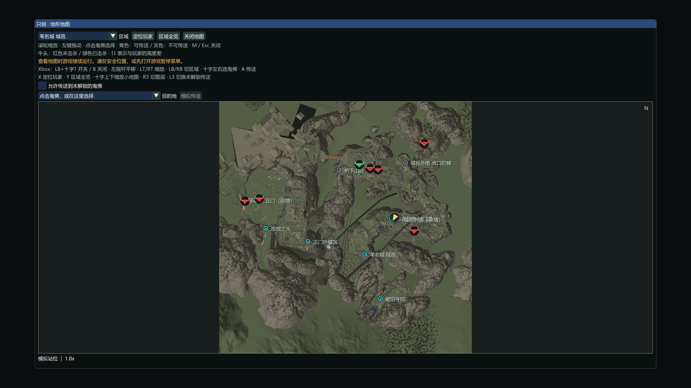

# Sekiro Atlas · 只狼地图

为《只狼：影逝二度》提供真实关卡地形小地图、大地图、鬼佛传送与 Boss 标记。Windows x64 / DirectX 11，当前版本 **0.5 Alpha**。



图中使用真实关卡模型生成的底图，但玩家站位、鬼佛和 Boss 状态均为模拟数据，用于绘制验证。

## 下载和运行

完整源码与构建依赖见 [SekiroAtlas-source-v0.5.zip](SekiroAtlas-source-v0.5.zip)，下载并解压后可查看、修改与构建。完整运行包见 [Releases](https://github.com/PanNeng-ZJU/sekiro-atlas/releases)。完整解压后，先启动游戏进入存档，再双击 `StartAtlas.exe`。保持 `maps` 文件夹与 DLL、启动器在同一目录。每次重启游戏后重新加载一次。

无需 Mod Engine。退出游戏即可结束本次加载；更新 DLL 前先正常退出游戏。

## 功能

- 右上角小地图，实时玩家位置和朝向，F6 / F7 缩放并保存。
- M 大地图，Esc 关闭，F9 隐藏；每次打开默认 **10 倍缩放、玩家居中**。
- 九个区域、13 张地表 / 高度图层；底图从用户本机 MSBS / FLVER 关卡模型生成。
- 大地图可勾选“允许传送到未解锁的鬼佛”，默认关闭，也可按 L3 切换并保存。剧情不可用、状态未知与玩家未就绪仍拦截。
- 63 条鬼佛记录；读取解锁与禁用旗标，点击图标或选择目的地后调用游戏原生传送流程。
- **55 个探索 Boss / 精英战斗位置**，包含无首、剧情变体、序章和屏风猿猴。红牛头未击杀，绿牛头当前周目已击杀；共享战斗阶段使用最终通关旗标。
- Xbox / XInput 手柄地图操作。地图打开时接管鼠标、键盘和手柄输入。

| Xbox 操作 | 功能 |
|---|---|
| LB＋十字键上 / B | 开关 / 关闭大地图 |
| 左摇杆，LT / RT | 平移，缩小 / 放大大地图 |
| LB / RB | 切换区域 |
| 十字键左右，A | 选择可传送鬼佛，传送 |
| X / Y | 玩家居中 / 区域全览 |
| 十字键上下 | 缩放小地图 |
| R3 | 切换图层 |
| L3 | 切换允许传送到未解锁鬼佛 |

除 LB＋十字键上外，手柄地图操作在大地图打开时生效。单独 LB / 十字键上松开时执行，组合键持续按住只触发一次；View 保留游戏原有功能。小地图显示新快捷键，校准控件已移除。

## 验证与当前限制

独立 DX11 测试验证绘制、缩放、分辨率切换、鼠标隔离、10 倍玩家居中、鬼佛选择与传送限制，以及合成 XInput 控制状态。九张地图模型完整性、55 个 Boss 的名称 / 坐标 / 击杀旗标经过资源检查。0.2 的游戏内显示、移动跟随、朝向、缩放和鼠标隔离曾由用户实测确认；0.4 运行日志已检测到手柄并记录原生鬼佛传送的地图加载完成。0.5 的新组合键和未解锁传送选项通过独立测试；真实设备操作、Boss 击杀变色与落点仍需进一步确认。

地形纹理按材质类别近似绘制；屋顶、洞穴、地下与梦境空间可能被地表总览遮挡。苇名城额外图层是试验高度切片。地图不会自动暂停游戏。“心中”系列没有独立探索地图位置；大白蛇和鲤鱼属于剧情事件，没有列入战斗血条标记。

## 构建和制图

原生插件为 C++17、Dear ImGui、MinHook 和 nlohmann/json；地图生成器为 .NET 10 与 SoulsFormats。第三方源码、构建脚本、精简 Boss 目录均包含在 `source`。

原生构建：

```powershell
.\source\Build.ps1 -ZigPath 'C:\path\to\zig.exe'
```

本次测试编译器为 Zig `0.12.0-dev.1286+cc394431a`。完整提取、生成与测试步骤见 源码包中的 `source/BUILD.md`。本仓库以源码压缩包提供完整源码与依赖；地图栅格与可运行二进制放在 Release 附件，不纳入 Git 历史。生成地图需要自己的游戏安装；Oodle 库只从本机游戏读取。

## 许可

原生插件和本项目原创工具代码采用 MIT，见 [LICENSE](LICENSE)。组合地图生成器链接 GPL-3.0 的 SoulsFormats，其源码与许可均已提供；第三方代码分别遵循其自身许可，见 源码包中的 `source/THIRD_PARTY.md`。MIT 不覆盖游戏素材、游戏名称、模型或文本。项目与 FromSoftware / Activision 无官方关联。
